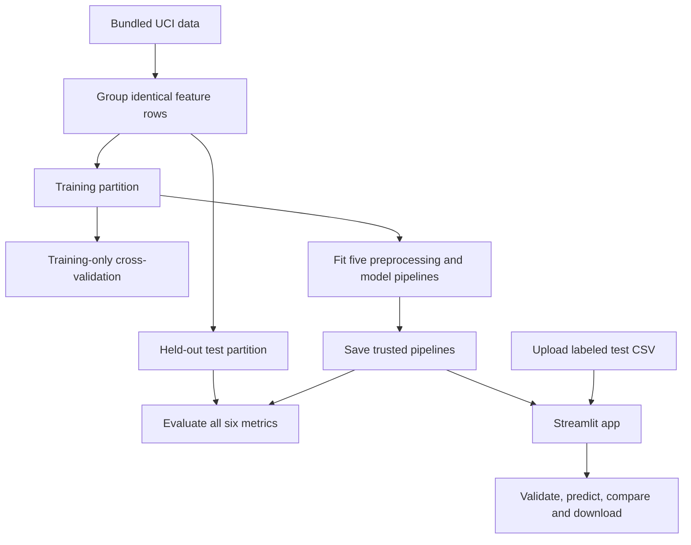

# Understand the project

## The problem in simple words

Each row describes an email using numbers: word percentages, character
percentages and capital-letter statistics. The target `spam` tells us whether
the email is unwanted (1) or normal (0). We compare five ways of learning that
relationship, then measure their mistakes on emails reserved for testing.

This is supervised binary classification: the historical training examples
already have labels, and there are two possible classes.

## Flow

## Why the split matters

An exam is useful only if the student has not memorized the exact questions.
Similarly, test rows must not be used to fit the model or preprocessing.
Spambase has repeated feature rows. We keep identical feature vectors in the
same partition, even if their labels disagree. This prevents an exact repeated
feature vector from appearing in both training and testing. It does not prove
all emails are statistically independent; near-duplicates and historical
collection biases can remain.

`StratifiedGroupKFold` attempts to balance the label proportions while honoring
the groups. We use its first fold as test data and the other four as training
data. The resulting counts are in `results/manifest.json`; the ratio is
approximately 80/20, not a claim of exactly 80/20.

## The five models

| Model | Simple explanation | Settings in this experiment |
|---|---|---|
| Logistic Regression | Adds weighted feature contributions to estimate a class probability. | C=1, max_iter=4000; standard scaling. |
| Decision Tree | Follows learned if/else questions to a predicted class. | max_depth=12, min_samples_leaf=3. |
| KNN | Looks at nearby training emails and votes, giving closer ones more weight. | 7 neighbors, distance weights; standard scaling. |
| Gaussian Naive Bayes | Combines class-specific feature distributions under a conditional-independence assumption. | GaussianNB, var_smoothing=1e-9. |
| SVM | Learns a separating boundary; the RBF kernel permits a curved boundary. | C=3, gamma=scale; standard scaling. |

These settings were fixed in the code. The project does not search settings on
the test set. Cross-validation reports variability on training data; it is not
used to repeatedly choose models based on the held-out results.

## Preprocessing and saved models

Each saved object is a scikit-learn Pipeline. Its first step fills missing
values with medians learned **only from training rows**. Logistic Regression,
KNN and SVM also use training-fitted StandardScaler values. Trees do not require
standard scaling, and GaussianNB is fitted to the imputed numeric features.

Saving the pipeline means the app cannot forget the scaler or fit a new one to
an uploaded file. The test CSV supplies inputs and known labels; labels are
used only for evaluation. The app never calls `fit`.

Only trusted model files bundled with the project are loaded with joblib. The
app never accepts uploaded pickle/joblib files.

## The metrics

Positive means spam. TP = actual spam predicted as spam; FP = normal email
incorrectly flagged; FN = spam missed; TN = normal email correctly left alone.

| Metric | Formula or interpretation |
|---|---|
| Accuracy | (TP + TN) / all emails. |
| Precision | TP / (TP + FP): how reliable is a spam alert? |
| Recall | TP / (TP + FN): how much spam is detected? |
| F1 | 2 x precision x recall / (precision + recall). |
| ROC AUC | Area under the curve of recall versus false-positive rate as score threshold varies. |
| MCC | (TP x TN - FP x FN) / sqrt((TP+FP)(TP+FN)(TN+FP)(TN+FN)). |

For zero-denominator precision/recall/F1 cases we explicitly use scikit-learn's
zero_division=0 convention. ROC AUC is unavailable when an uploaded CSV contains
only one actual class. MCC follows scikit-learn's convention for degenerate cases.

SVM emits a signed distance-like decision score here, not a probability. AUC
uses that continuous score. Other classifiers supply their spam probabilities.
Using hard predicted labels as AUC scores would discard ranking information.

## Read the results carefully

All five models see exactly the same held-out rows. The highest F1 model is the
reported winner for this experiment; AUC breaks a tie. This is a descriptive
result, not proof that it will always be best. A real spam system might prioritize
reducing false alarms on legitimate mail, which could change the decision.

Naive Bayes can have strong recall but weaker precision. Inspect its actual
false-alarm and missed-spam counts rather than assuming all high-recall models
are preferable. Explanations involving distributions or feature dependence
are hypotheses unless separately tested.

## What each file does

| File or folder | Purpose |
|---|---|
| app.py | Streamlit UI; selects saved models, validates CSVs, displays metrics and plots. |
| train.py | Deterministic split, training-only CV, final fitting, saving and test evaluation. |
| evaluate.py | Command-line saved-model evaluation without retraining. |
| src/core.py | Shared feature schema, model definitions, CSV validation and metric computation. |
| model/*.joblib | Five saved preprocessing/classifier pipelines. |
| model/schema.json | Required feature names, target and label meaning. |
| test_data.csv | Labeled held-out rows for uploads and reproducible evaluation. |
| data/spambase.data | Original numeric dataset, without column headers. |
| data/spambase.names | Official feature definitions. |
| data/spambase.DOCUMENTATION | Original dataset documentation. |
| data/ATTRIBUTION.md | Source citation, license and derived-data notice. |
| data/feature_schema.csv | Machine-readable named feature schema. |
| results/metrics.csv | All six held-out metrics for all five models. |
| results/evaluation.json | Confusion counts, classification reports and fit times. |
| results/cross_validation.csv | Training-only five-fold accuracy/F1/AUC mean and standard deviation. |
| results/split_membership.csv | Every source row's train/test assignment. |
| results/*_predictions.csv | Test prediction and score for every model. |
| results/manifest.json | Dataset hash, versions, split counts and provenance. |
| assets/ | Test comparison, ROC and confusion-matrix figures. |
| tests/test_project.py | Leakage, result consistency and malformed-input checks. |
| tests/smoke_app.py | Exercises all app model views and rejects any fit call. |
| scripts/update_readme.py | Regenerates the required README from current measured results. |
| scripts/build_submission.py | Builds the ordered submission PDF from links, screenshot and README. |
| submission_config.json | Blank example metadata; keep completed personal values private. |
| requirements.txt | Exact tested runtime dependencies for the app and training. |
| requirements-dev.txt | Additional dependencies for PDF generation. |
| .streamlit/config.toml | App theme and upload-size limit. |
| .github/workflows/check.yml | GitHub checks for model consistency and app execution. |
| START_HERE.md | Setup, lab reproduction, GitHub, deployment and PDF steps. |

## Small demo narrative

1. "Our dataset has 57 numeric features. We predict spam or non-spam."
2. "Training examples teach the model; test examples measure it. Duplicates stay together."
3. "These are five different learning approaches on one common split."
4. "Accuracy is overall correctness. Precision is alert reliability; recall is spam caught."
5. "This confusion matrix shows the actual mistakes."
6. "When I upload test data, we load saved pipelines and evaluate; no retraining happens."
7. "This historical experiment is educational. Modern email needs representative new data."
