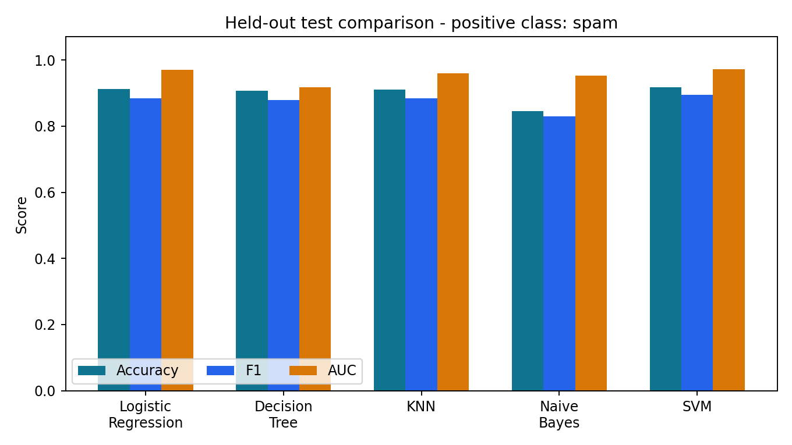
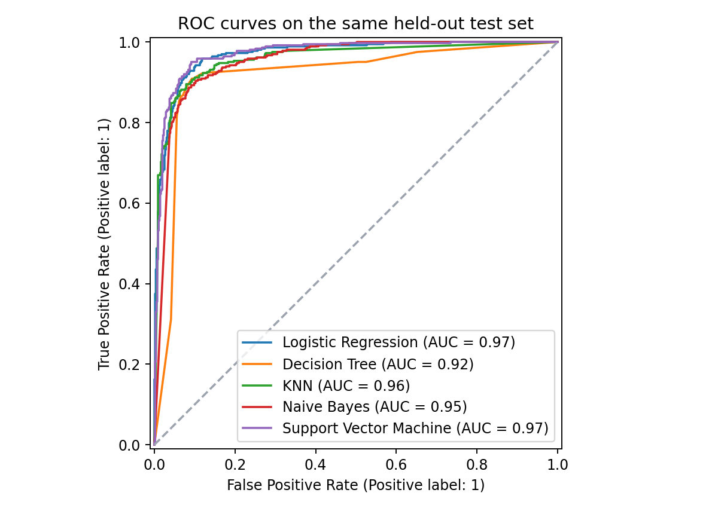

# SpamScope - five-model email classification comparison

M.Tech (AIML), Machine Learning - Assignment 2

Live application: https://deva-bits-ml-spambase.streamlit.app/

Public source: https://github.com/Devapradeepreddy/bits-ml-spambase

## a. Problem statement

Classify an email as spam (1) or non-spam (0) from 57 precomputed numeric
features. Implement Logistic Regression, Decision Tree, K-Nearest Neighbors,
Gaussian Naive Bayes and Support Vector Machine on the same dataset and compare
Accuracy, ROC AUC, Precision, Recall, F1 and MCC on one common held-out test set.
Provide an interactive Streamlit application that evaluates saved models on
labeled uploaded test CSVs without retraining them.

## b. Dataset description

- Dataset: UCI Spambase, a public binary classification dataset.
- Source: https://archive.ics.uci.edu/dataset/94/spambase
- Citation: Hopkins, M., Reeber, E., Forman, G., & Suermondt, J. (1999). Spambase [Dataset]. UCI Machine Learning Repository. DOI: https://doi.org/10.24432/C53G6X
- License: CC BY 4.0; see data/ATTRIBUTION.md.
- Instances: 4,601; input features: 57 (meets at least 500 instances and 12 features).
- Features: 48 word frequencies, 6 character frequencies and 3 capital-run statistics.
- Target: spam; 0 = non-spam, 1 = spam. Total counts: 2,788 non-spam and 1,813 spam.
- Missing feature cells in the original data: 0.
- Duplicate feature rows beyond the first occurrence: 394.
- Identical-feature groups containing conflicting class labels: 3.
- Group-aware partition: 3,680 training rows and 921 test rows; shared exact feature groups: 0.
- Training class counts: 2230 non-spam / 1450 spam.
- Test class counts: 558 non-spam / 363 spam.

The target is excluded from all input features. Exact duplicate feature vectors
remain together using the first fold from StratifiedGroupKFold with five folds,
shuffle=True and random_state=42. No source rows are dropped. Groups are based
on features, not labels, so contradictory copies also remain together. This
prevents exact-copy overlap, while near-duplicate or collection-source effects
can still exist. Data originated in 1999 and contain person-specific indicators;
the results are not evidence of performance on present-day email.

## c. GitHub repository and live application

GitHub repository: https://github.com/Devapradeepreddy/bits-ml-spambase

Live Streamlit application: https://deva-bits-ml-spambase.streamlit.app/

The repository includes app.py, requirements.txt, README.md, test_data.csv,
training source, all five saved models, preprocessing pipelines, original data,
result tables, figures, tests and deployment instructions. The app entrypoint
is app.py. Deploy with Python 3.12 and the pinned requirements.txt.

## d. Models used and evaluation metrics

All metrics below are measured on the same held-out test rows. Precision,
Recall and F1 use spam (1) as the positive class. ROC AUC uses continuous spam
probabilities for four models and decision scores for SVM. It is not computed
from hard class predictions. MCC lies between -1 and 1; the other reported
metrics lie between 0 and 1.

| Model | Accuracy | AUC | Precision | Recall | F1 | MCC |
| --- | --- | --- | --- | --- | --- | --- |
| Logistic Regression | 0.9121 | 0.9705 | 0.9123 | 0.8595 | 0.8851 | 0.8149 |
| Decision Tree | 0.9066 | 0.9175 | 0.8946 | 0.8650 | 0.8796 | 0.8036 |
| KNN | 0.9099 | 0.9593 | 0.9000 | 0.8678 | 0.8836 | 0.8105 |
| Naive Bayes | 0.8458 | 0.9531 | 0.7336 | 0.9559 | 0.8301 | 0.7138 |
| Support Vector Machine | 0.9186 | 0.9723 | 0.9138 | 0.8760 | 0.8945 | 0.8287 |

### Preprocessing and fixed model settings

| Model | Configuration |
| --- | --- |
| Logistic Regression | Training median imputation, StandardScaler, C=1, max_iter=4000, seed=42. |
| Decision Tree | Training median imputation, max_depth=12, min_samples_leaf=3, seed=42. |
| KNN | Training median imputation, StandardScaler, n_neighbors=7, weights=distance. |
| Naive Bayes | Training median imputation, GaussianNB with var_smoothing=1e-9. |
| Support Vector Machine | Training median imputation, StandardScaler, SVC with RBF kernel, C=3, gamma=scale, seed=42. |

Imputers and scalers are fitted within each training fold and the final training
partition only. Uploaded test data never fit or update any preprocessing or
classifier. Saved Pipeline objects contain every required transformation.
Settings are fixed rather than selected by repeated holdout trials.

### Training-only five-fold cross-validation

| Model | Accuracy mean +/- SD | F1 mean +/- SD | AUC mean +/- SD |
| --- | --- | --- | --- |
| Logistic Regression | 0.9119 +/- 0.0177 | 0.8879 +/- 0.0192 | 0.9576 +/- 0.0188 |
| Decision Tree | 0.9027 +/- 0.0134 | 0.8743 +/- 0.0161 | 0.9067 +/- 0.0091 |
| KNN | 0.9062 +/- 0.0094 | 0.8789 +/- 0.0115 | 0.9514 +/- 0.0091 |
| Naive Bayes | 0.8188 +/- 0.0124 | 0.8052 +/- 0.0123 | 0.9410 +/- 0.0149 |
| Support Vector Machine | 0.9342 +/- 0.0050 | 0.9146 +/- 0.0064 | 0.9724 +/- 0.0048 |

The folds are group-aware. Standard deviations describe variation across these
five folds; they are not confidence intervals. These training-only scores are
separate from the mandatory held-out comparison table above.

## e. Observations on model performance

| ML Model Name | Observation about model performance |
| --- | --- |
| Logistic Regression | Accuracy 0.9121; spam precision 0.9123, recall 0.8595, F1 0.8851. 30 normal emails flagged and 51 spam emails missed. The scaled linear baseline provides a useful reference for the nonlinear methods. |
| Decision Tree | Accuracy 0.9066; spam precision 0.8946, recall 0.8650, F1 0.8796. 37 normal emails flagged and 49 spam emails missed. Its depth and minimum leaf size are limited; the observed results reflect this fixed configuration. |
| KNN | Accuracy 0.9099; spam precision 0.9000, recall 0.8678, F1 0.8836. 35 normal emails flagged and 48 spam emails missed. Distance-weighted voting uses seven neighbors after scaling, so feature magnitude does not set the distance by itself. |
| Naive Bayes | Accuracy 0.8458; spam precision 0.7336, recall 0.9559, F1 0.8301. 126 normal emails flagged and 16 spam emails missed. It catches many spam examples but also produces more false alarms here. Gaussian feature shapes and conditional independence are modeling assumptions, not verified explanations for the gap. |
| Support Vector Machine | Accuracy 0.9186; spam precision 0.9138, recall 0.8760, F1 0.8945. 30 normal emails flagged and 45 spam emails missed. The scaled RBF model achieves the highest F1 in this run. ROC AUC uses its decision margins, not probabilities. |
| Overall winner for this dataset | Support Vector Machine by held-out spam F1 (0.8945); accuracy 0.9186, AUC 0.9723. This is a descriptive comparison on this split, not a universal ranking or a tuned deployment decision. |

This experiment prioritizes spam F1 for the descriptive winner and uses AUC as
a tie-breaker. A real deployment may prioritize reducing false alarms instead.
Neither this split nor the cross-validation establishes a universal best model.





## Application features

- Labeled test CSV upload with required-column, numeric-value and binary-target validation.
- A dropdown for all five classifiers and an included test-data example.
- Six evaluation metrics; AUC is shown as unavailable for a one-class CSV.
- Confusion matrix, classification report and ROC curve.
- A comparison table calculated on the active test rows for every saved model.
- Downloadable sample data, predictions and comparison metrics.
- Median imputation for individual blank feature values using training-fitted medians.
- No retraining, API keys or remote model calls in the app.

The app accepts extracted Spambase numeric features, not raw email text. User
uploads must be truly held out to support generalization claims. Only trusted
local model artifacts are deserialized; no uploaded model files are accepted.

## Run, reproduce and check

```bash
python -m pip install -r requirements.txt
python -m streamlit run app.py
```

```bash
python train.py
python -m unittest discover -s tests -p 'test_*.py' -v
python tests/smoke_app.py
python evaluate.py --csv test_data.csv --model all
python scripts/update_readme.py
```

The raw dataset is bundled, so training does not require a dataset download.
Use Python 3.12 and scikit-learn==1.8.0 for artifact compatibility.
Detailed operating instructions are in START_HERE.md; file explanations and
metric definitions are in EXPLANATION.md.

## Evidence and reproducibility

- Dataset SHA-256: b1ef93de71f97714d3d7d4f58fc9f718da7bbc8ac8a150eff2778616a8097b12
- Held-out CSV SHA-256: 08c96e713afe0645cbc62daa0ce12edca9da033e52fe20f532682b40d05c2f8b
- Python: 3.12.14; scikit-learn: 1.8.0; NumPy: 2.3.5; pandas: 2.2.3.
- Split membership: results/split_membership.csv.
- Predictions: results/*_predictions.csv; confusion counts: results/evaluation.json.
- Full provenance and creation time: results/manifest.json.

The initial packaged execution was performed in a development runtime. It is
not BITS Virtual Lab execution proof. The student must execute the assignment
in the required lab and supply a genuine screenshot for the final PDF.

## Deployment and submission

Use Streamlit Community Cloud with this repository, branch main, entrypoint
app.py and Python 3.12. See START_HERE.md for the exact sequence and official
documentation links. A repository or app URL is pending until it has really
been created and opened; no placeholder is a valid submission link.

The final PDF must contain, in order, the working GitHub link, live Streamlit
link, genuine BITS Virtual Lab execution screenshot and the complete README.
Run scripts/build_submission.py with completed metadata and your screenshot.
Personal screenshots and the final PDF belong in private_submission/, which
is excluded from Git. A draft PDF with missing items is not ready to submit.
